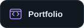
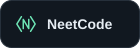
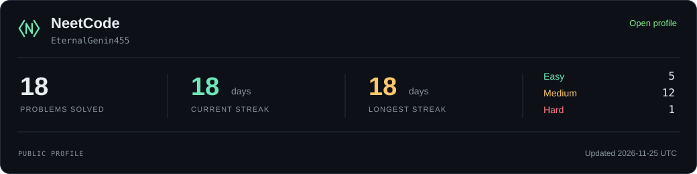

  <picture>
    <source media="(prefers-reduced-motion: reduce)" srcset="./assets/hero-static.svg" />
    
  </picture>

  
  
  
  
  
  
  

  

## `whoami`

Building useful software, explaining what I learn, and getting **1% better every day**.

## `ls ~/skills`

  
Explore my stack

| Full Stack | Cloud & DevOps | Data & Databases | AI & Vision |
| --- | --- | --- | --- |
| React · Next.js · TypeScript | AWS · Azure · Docker | PostgreSQL · MongoDB · DynamoDB | OpenAI · LangChain · Qdrant |
| Node.js · Spring Boot · FastAPI | GitHub Actions · Git · Vercel | SQL · Python · Pandas | RAG · AI Agents |
| React Native · Tailwind | EC2 · S3 · ECS · Cognito | Matplotlib · Tableau | TensorFlow · Keras · OpenCV |

**Testing:** JUnit · PyTest · Jest · Playwright · Postman · SonarQube

## `git log --stat`

  

## `cat ~/practice/leetcode`

  

## `cat ~/practice/neetcode`

 

  <b>Have an idea worth building?</b> 
  <a href="mailto:divyu2004@gmail.com">Let’s talk.</a>

