<p align="center">
  <picture>
    <source
      media="(prefers-color-scheme: dark)"
      srcset="./assets/name-heatmap-dark.svg"
    />
    <source
      media="(prefers-color-scheme: light)"
      srcset="./assets/name-heatmap-light.svg"
    />
    
  </picture>
</p>


<p>
  <a href="https://divyanshu-dugar.me"></a>
  <a href="https://www.linkedin.com/in/divyanshu-dugar/"></a>
  <a href="https://twitter.com/DivyanshuDugar"></a>
  <a href="https://leetcode.com/u/divyanshu-dugar/"></a>
  <a href="https://www.youtube.com/@frontbenchers_21"></a>
  <a href="mailto:divyu2004@gmail.com"></a>
</p>


</div>

<br/>

## `whoami`

```typescript
const divyanshu = {
  role:       "Full-Stack Developer & AI Builder",
  location:   "Toronto, Canada",
  education:  "Computer Programming & Analysis @ Seneca Polytechnic",
  focus:      ["Full-Stack", "AI / LLMs", "RAG Pipelines", "Fintech"],
  philosophy: "1% wiser every single day",
  openTo:     ["Full-time opportunities", "Open Source", "Collaborations"],
};
```

> Building AI-powered products that solve real problems — currently deep in **RAG pipelines**, **LLM applications**, and **fintech tooling**. Check out my pinned projects below 👇

<br/>


## `touch tech-stack`

<div align="center">

[](https://skillicons.dev)

</div>

<br/>


## `touch github-stats`

<div align="center">

[](https://git.io/streak-stats)

</div>

## `touch leetcode`

<div align="center">
  
[](https://leetcode.com/u/divyanshu-dugar/)

</div>

<br/>


<div align="center">

### *"The best way to predict the future is to build it."*

**Have an idea worth building?** Let's talk.

</div>
